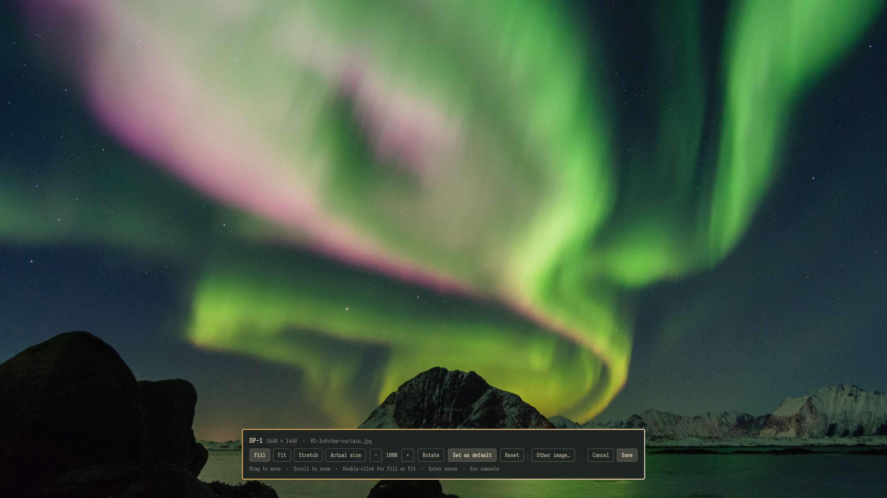
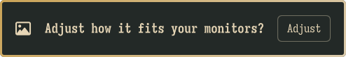

# Wallpaper Framing

Per-monitor wallpaper framing for [Omarchy](https://omarchy.org), built around
the native wallpaper picker instead of replacing it.



Pick a wallpaper the way you always do. When the picker closes, a small offer
appears where the OSD sits:

<p align="center"></p>

Take it and the windows fade away, leaving the wallpaper on every screen. Drag
it into place, scroll to zoom, press Enter. Each wallpaper remembers how it
sits on each monitor, so the next time you pick it, it is already framed.

Ignore the offer and it leaves after six seconds. Nothing else about the
desktop changes: double-click still opens the native picker, right
double-click the theme picker, and the slanted reveal, theme switches and
video wallpapers (OWE) work as they do in stock Omarchy.

## What you can set, per wallpaper and per monitor

- **Position**: drag the image, or nudge it with the arrow keys.
- **Zoom**: scroll, or `+` and `-`. The point under the pointer stays put.
- **Sizing**: Fill (cover and crop), Fit (whole image, blurred bars), Stretch,
  or Actual size (one image pixel per screen pixel).
- **Rotation**: quarter turns.
- **Another image**: show a different picture on one monitor whenever this
  wallpaper is set. Themes that ship a 16:9 and an ultrawide version of each
  wallpaper can pair them this way. The image is chosen in the native picker.
- **Set as default**: make the current framing (and image, if the monitor
  has its own) that monitor's default, for wallpapers with nothing saved.

## Framing mode

| | |
|---|---|
| Drag | Move the image |
| Scroll, `+`, `-` | Zoom |
| Double-click | Switch between Fill and Fit |
| Arrow keys | Nudge 24 px; with Shift 1 px, with Ctrl 120 px |
| `1` `2` `3` `4` | Fill, Fit, Stretch, Actual size |
| `0` | Back to 100% |
| `R`, Shift+`R` | Rotate clockwise, counterclockwise |
| Backspace | Reset this monitor to its default framing |
| Tab | Move the controls to the next monitor |
| Enter | Save |
| Esc | Cancel |

The controls follow the pointer: the monitor it is on shows them, the others
show a caption.

## Other ways in

- Double-click the desktop with the **middle** button.
- `omarchy-shell wallpaper-framing open`
- A row in the Omarchy menu, in `~/.config/omarchy/extensions/omarchy-menu.jsonc`:

  ```jsonc
  "appearance.framing": {"icon":"","label":"Background Framing","action":"omarchy-shell wallpaper-framing open"},
  ```

- A key, in `~/.config/hypr/bindings.lua`:

  ```lua
  o.bind("SUPER + CTRL + ALT + SPACE", "Background framing", "omarchy-shell wallpaper-framing open")
  ```

## Install

Needs Omarchy 4.5 or newer. From the marketplace, or by hand:

```bash
omarchy plugin add https://github.com/Dielerorn/omarchy-wallpaper-framing --enable
omarchy restart shell
```

The plugin takes the place of Omarchy's built-in background service, which
the shell switches off while this one is enabled and back on when it is
disabled or removed. Only one plugin can draw the wallpaper, so if you already
use another background plugin, disable that one first. For Omarchy Monitor
Wallpapers that is:

```bash
omarchy plugin disable suhayb.background
```

It uses ImageMagick (`magick`) to read image sizes and Hyprland's `hyprctl` to
find the pointer. Omarchy installs both, and nothing else is needed. The only
file it writes is its own settings file, described below.

## Update

```bash
omarchy plugin update dielerorn.wallpaper-framing
omarchy restart shell
```

## Remove

```bash
omarchy plugin remove dielerorn.wallpaper-framing
omarchy restart shell
```

This switches Omarchy's built-in background back on. Your settings and saved
framings stay in `~/.config/omarchy/wallpaper-framing.json`; delete that file
if you do not want them kept.

## Settings

`~/.config/omarchy/wallpaper-framing.json`, read live:

```json
{
  "version": 1,
  "settings": {
    "afterPick": "ask",
    "askSeconds": 6,
    "backdrop": "blur"
  }
}
```

- `afterPick`: `ask` shows the offer, `open` goes straight into framing mode
  once the reveal has played, `off` does neither.
- `askSeconds`: how long the offer stays, 2 to 60.
- `backdrop`: what shows around an image that does not cover the screen,
  `blur` (the image itself, blurred and dimmed) or `color` (the theme's
  background color).

The same file holds the saved framings under `frames` and the per-monitor
defaults under `defaults`. Theme wallpapers are named by theme and file
(`theme:nord/1.jpg`), so two themes that both ship `1.jpg` keep separate
framings.

## IPC

Target `wallpaper-framing`:

| Call | |
|---|---|
| `open`, `save`, `cancel`, `toggle` | Framing mode |
| `ask` | Show the offer |
| `frame <monitor> <json>` | Set a framing, e.g. `'{"mode":"fill","ay":0}'` |
| `image <monitor> <path>` | Give the monitor its own image for the current wallpaper |
| `follow <monitor>` | Show the wallpaper itself on the monitor again |
| `reset <monitor>` | Back to the monitor's default framing |
| `state` | Everything above as JSON |

In a framing, `ax` and `ay` run from 0 to 1 and say which edge the image
holds to: 0 keeps its left or top edge, 1 its right or bottom. With framing
mode closed these calls save at once.

The stock `background` target answers as before.

## Notes

- The offer follows a pick from the native picker only. Theme switches and
  `omarchy theme bg next` apply the saved framing without asking.
- Images are decoded at about the size they are drawn, as in stock Omarchy,
  and never above three screens' worth of pixels, so a deep zoom into a very
  large image softens instead of filling video memory.
- A video wallpaper is drawn by OWE and is not framed here. A monitor can
  still be given a still of its own while one plays.
- An image of a monitor's own that goes missing is skipped, and the monitor
  shows the wallpaper again.

## Tests

```bash
node --test tests/
```

## License

MIT. `Background.qml` is derived from Omarchy's background plugin.

The photo in the preview is
[Lofoten, Norway](https://commons.wikimedia.org/wiki/File:Lofoten,_Norway_(Unsplash).jpg)
by Johannes Groll, released under CC0.
